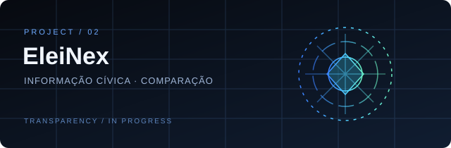

  
  
  

## 01 / SOBRE MIM

Sou **Jonathan Otiniel**, Técnico em Desenvolvimento de Sistemas pela Etec e desenvolvedor em formação, construindo minha trajetória rumo ao **Full Stack**.

Gosto de transformar ideias em sistemas claros, úteis e bem estruturados. Meu foco é evoluir continuamente em lógica, arquitetura, experiência de uso e integração entre interface, regras de negócio e dados.

> **Aprender. Conectar. Construir.**  
> Cada projeto é uma oportunidade de entender melhor o problema, estruturar uma solução e melhorar a execução.

  

## 02 / PROJETOS EM DESTAQUE

<table>
  <tr>
    <td width="50%" valign="top">
      
      
<strong><a href="https://github.com/joots28/ChurchMennager">ChurchManager</a></strong>

      Sistema em desenvolvimento para centralizar informações, membros, ministérios, eventos e movimentações de uma igreja.
      
GESTÃO DE DADOS · ORGANIZAÇÃO · SISTEMA WEB

    </td>
    <td width="50%" valign="top">
      
      
<strong><a href="https://github.com/joots28/portifolio/tree/eleinexus-site/eleinexus">EleiNex</a></strong>

      Projeto de informação cívica focado em tornar propostas e informações eleitorais mais fáceis de explorar e comparar.
      
INFORMAÇÃO CÍVICA · TRANSPARÊNCIA · COMPARAÇÃO

    </td>
  </tr>
</table>

<a href="https://jonathan-otiniel-portfolio-v3.onrender.com/#projetos">VER PORTFÓLIO COMPLETO ↗</a>

  

## 03 / TECNOLOGIAS

Tecnologias que estudo e utilizo na minha jornada de desenvolvimento:

  
  
  
  
  
  
  

  

## 04 / COMO EU CONSTRUO

<table>
  <tr>
    <td width="25%" align="center" valign="top">
      <strong>01 / ENTENDER</strong>  
      Investigar o problema antes de escolher a solução.
    </td>
    <td width="25%" align="center" valign="top">
      <strong>02 / ESTRUTURAR</strong>  
      Organizar componentes, dados e responsabilidades.
    </td>
    <td width="25%" align="center" valign="top">
      <strong>03 / DESENVOLVER</strong>  
      Transformar a ideia em partes que se conectam.
    </td>
    <td width="25%" align="center" valign="top">
      <strong>04 / REVISAR</strong>  
      Testar, corrigir e evoluir com intenção.
    </td>
  </tr>
</table>

  

## 05 / PRÓXIMA VERSÃO

Meu objetivo é ampliar minha visão de desenvolvimento: da interface à lógica, da lógica aos dados, sempre com atenção à clareza, manutenção e experiência de quem usa o sistema.

 

JONATHAN OTINIEL · DESENVOLVIMENTO EM EVOLUÇÃO · 2026

